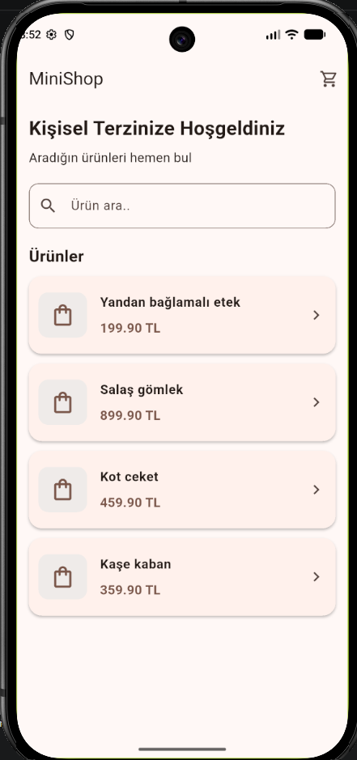
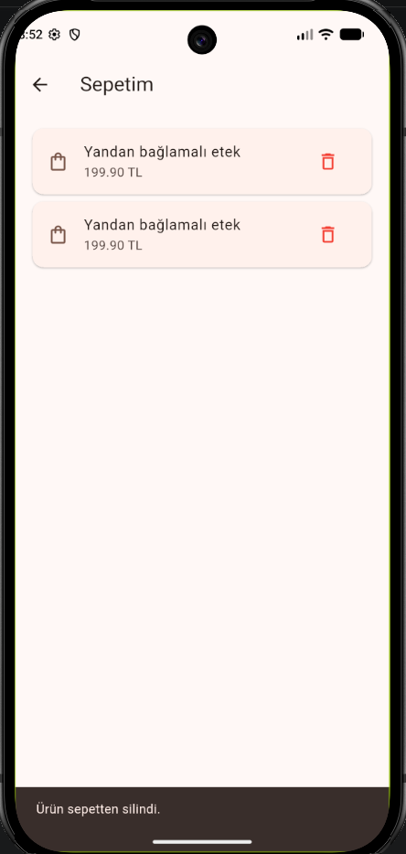
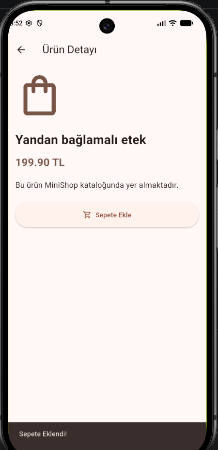

# MiniShop 🛍️

Flutter kullanılarak geliştirilen, ürünleri listelemeyi, aramayı, ürün detaylarını görüntülemeyi ve alışveriş sepetini yönetmeyi sağlayan basit bir mobil katalog uygulaması.

## ✨ Özellikler

- Ürünleri listeleme
- Ürün adına göre arama ve filtreleme
- Ürün detaylarını görüntüleme
- Ürünleri alışveriş sepetine ekleme
- Sepetteki ürünleri listeleme
- Sepet toplam tutarını hesaplama
- Sepetten ürün silme

## 🛠️ Kullanılan Teknolojiler

- Flutter
- Dart
- Material Design

## 📁 Proje Yapısı

```text
lib/
├── main.dart
├── cart.dart
└── screens/
    ├── product_detail_screen.dart
    └── cart_screen.dart
```

## 🚀 Kurulum ve Çalıştırma

1. Bu depoyu bilgisayarına klonla:

   ```bash
   git clone REPOSITORY_URL
   ```

2. Proje klasörüne gir:

   ```bash
   cd minishop-flutter
   ```

3. Gerekli paketleri yükle:

   ```bash
   flutter pub get
   ```

4. Uygulamayı çalıştır:

   ```bash
   flutter run
   ```

## 📱 Ekran Görüntüleri

 
 
 


## 👩‍💻 Geliştirici

Meryem Selvi
